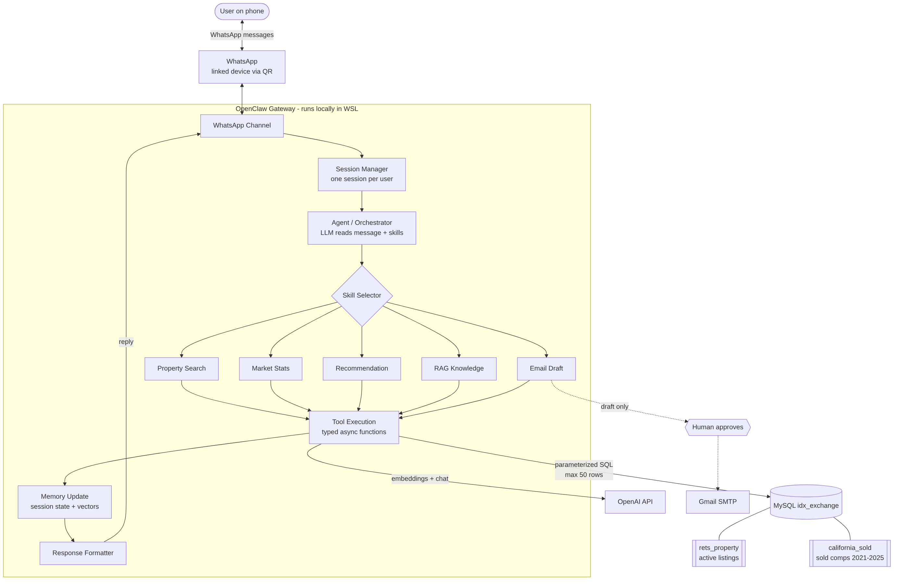

# IDX Multi-Agent Real Estate Assistant

Multi-agent AI assistant built on [OpenClaw](https://github.com/openclaw/openclaw) for IDX Exchange. It answers California real estate questions over WhatsApp using two real MLS tables: `rets_property` (55K active listings) and `california_sold` (98K sold comps). Runs on Claude via OpenClaw.

Built by Riyan · IDX Exchange Agentic AI Engineering Intern, Fall 2026



## Progress

| Week | Module | Status | Deliverable |
|---|---|---|---|
| 0 | Environment Setup | Done | [Setup guide](docs/WEEK0_SETUP.md), [data notes](docs/DATA_NOTES.md), `scripts/import_db.sh`, `scripts/verify_db.py`, `scripts/verify_keys.py` |
| 1 | Architecture Fundamentals | Done | [Architecture doc + workflow diagram](docs/ARCHITECTURE.md) |
| 2 | NL Property Search | Done | [Week 2 doc](docs/WEEK2_NL_SEARCH.md), `src/search/parsePropertyQuery.ts`, 17 passing tests, `skills/property-query-parser` |
| 3 | Database Integration | Done | [Week 3 doc](docs/WEEK3_DB_INTEGRATION.md), `src/db/`, `npm run search`, `npm run comps`, 28 unit + 6 DB tests, `skills/property-search` |
| 4 | Conversational Agent | Done | [Week 4 doc](docs/WEEK4_SESSION_MEMORY.md), `src/session/`, `src/agent/`, `npm run chat` (more / refine / details / new city / reset), `skills/idx-assistant` |
| 5 | Market Analytics | Done | [Week 5 doc](docs/WEEK5_MARKET_STATS.md), `src/market/`, `npm run market` (medians, $/sqft, DOM, sale-to-list, inventory, trend, compare) |
| 6 | Embeddings & Vector Search | Done | [Week 6 doc](docs/WEEK6_SEMANTIC_SEARCH.md), `src/semantic/`, `npm run embed:index`, `npm run semantic` (Gemini or OpenAI embeddings, hybrid SQL + vector ranking) |
| 7 | Recommendation Engine | Done | [Week 7 doc](docs/WEEK7_RECOMMENDATIONS.md), `src/recommend/`, `npm run recommend` (fit + value vs sold comps + freshness + likes, "homes like #2", explanations) |
| 8 | RAG Pipeline | | |
| 9 | Multi-Agent Orchestration | | |
| 10 | WhatsApp Layer | | |
| 11 | Email Agents & Safety | | |
| 12 | Capstone Demo | | |

## Repo layout

```
docs/            setup guide, architecture doc, diagrams
scripts/         import + verification scripts
skills/          OpenClaw skills (copy into ~/.openclaw/workspace/skills/)
src/tools/       Week 1 example tool
src/search/      Week 2 parser + search CLIs
src/db/          Week 3 MySQL pool, parameterized queries, property cards
src/session/     Week 4 per-user session memory + follow-up rules
src/agent/       Week 4-6 message router (npm run chat), market routing
src/market/      Week 5 market stats
src/semantic/    Week 6 embeddings, vector store, hybrid search
src/recommend/   Week 7 recommendation engine (scoring, likes, similar homes)
tests/           unit tests (npm test) and DB tests (npm run test:db)
sql/             DB/user setup (MLS dumps go in data/, which is gitignored)
```

## Quick start

See [docs/WEEK0_SETUP.md](docs/WEEK0_SETUP.md). Short version (WSL Ubuntu):

```bash
python3 -m venv venv && source venv/bin/activate
pip install -r requirements.txt
cp .env.example .env            # fill in keys (Anthropic + MySQL)
bash scripts/create_db_user.sh  # DB + user, password read from .env
bash scripts/import_db.sh       # imports data/*.sql in fast mode
python scripts/verify_db.py
python scripts/verify_keys.py
npm install -g openclaw@latest && openclaw onboard --install-daemon   # Anthropic key + WhatsApp QR
```

Day to day:

```bash
npm install
npm test && npm run test:db
npm run -s chat -- --user me "3 bed condos in Irvine under 1.5M"
npm run -s chat -- --user me "how's the Irvine condo market?"
npm run -s chat -- --user me "best deals in Irvine under 1.5M"
npm run embed:index -- --city Irvine && npm run -s chat -- --user me "quiet street with a big backyard in Irvine"
cp -r skills/idx-assistant ~/.openclaw/workspace/skills/
```

## Safety

- Secrets live only in `.env` (gitignored). Never commit keys or MLS dumps.
- All SQL is parameterized, max 50 rows per query.
- Emails are draft-then-approve, never sent automatically.
