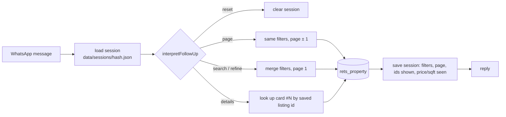

# Week 4: Session Memory and Follow-ups

**Goal:** remember each user's last search so follow-ups refine it instead of starting over.

## What it does

```
You:  3 bed condos in Irvine under 1.5M     -> new search, cards 1-5
You:  only ones with a pool                  -> same search + pool, back to page 1
You:  more                                   -> cards 6-10
You:  tell me about #7                       -> full details + description
You:  what about Tustin                      -> same filters, new city
You:  cheaper                                -> max price 15% lower
You:  start over                             -> session cleared
```

| Follow-up | What happens |
|---|---|
| more / next / back | next or previous page of the same search |
| tell me about #2, the second one, number 4 | details card for that listing (uses the card number they saw) |
| only ones with a pool, under 900k, no HOA | old filters + new ones |
| what about Tustin, try Yorba Linda | swap the city, keep everything else |
| cheaper / more expensive | max price -15% / +25% (from their max, or from what was shown) |
| bigger / more bedrooms | min sqft +20% / beds +1 |
| any price, pool doesn't matter, any type | drop that filter |
| sort by newest, most expensive first | re-sort, keep filters |
| start over, new search | clear the session |
| a full new request (city + type/beds/price) | fresh search, old filters dropped |
| no city given | asks "Which city?" and keeps the filters; a bare reply like "Yorba Linda" fills it in |
| anything else ("thanks!") | `NOT_A_PROPERTY_REQUEST`, the agent answers normally |

## How it works



- `src/session/sessionStore.ts`: session shape, file store (JSON per user) and in-memory store for tests. Sessions expire after `SESSION_TTL_MINUTES` (default 120).
- `src/session/followUp.ts`: pure rules that turn a message + session into an action. No LLM, so it's fast, free and fully tested.
- `src/agent/handleMessage.ts`: runs the action, saves the session, builds the reply. DB functions are injected so tests use a fake DB.
- `src/agent/chatCli.ts`: `npm run chat` entry point for OpenClaw.
- `src/db/queries.ts` + `listings.ts`: new `getListingById()` for details (includes `L_Remarks`).
- `skills/idx-assistant/SKILL.md`: the new main skill.

### Design choices

- **Session = our own file, not the LLM's chat history.** The LLM can forget or rewrite filters. A saved filter object is exact, survives gateway restarts, and is easy to test.
- **Card numbers are global.** Page 2 shows #6-#10, so "tell me about #7" works on page 2. The session stores which listing id is behind each number.
- **Privacy.** Session files are named by a SHA-256 hash of the sender id, so phone numbers don't appear in file names. `data/` is gitignored.
- **Refine vs new search.** A message with a city plus type/beds/price is treated as a new search, unless it starts like a tweak ("what about...", "only...", "try...").

## Run it

```bash
cd ~/idx-openclaw-assistant
npm test                                   # includes 30+ new Week 4 tests
npm run -s chat -- --user me "3 bed condos in Irvine under 1.5M"
npm run -s chat -- --user me "only ones with a pool"
npm run -s chat -- --user me "more"
npm run -s chat -- --user me "tell me about #2"
npm run -s chat -- --user me --session     # see what's saved
npm run -s chat -- --user me --reset
```

Install the skill (and remove the stateless one so the agent doesn't mix them up):

```bash
cp -r skills/idx-assistant ~/.openclaw/workspace/skills/
rm -rf ~/.openclaw/workspace/skills/property-search
```

## Known limits

- Rules only understand the phrasings above. Very free-form follow-ups ("something more modern") fall through to the agent. Week 6 semantic search covers descriptive requests.
- WhatsApp `/new` resets the OpenClaw chat, not our search session. Say "start over" for that (or wait 2 hours).
