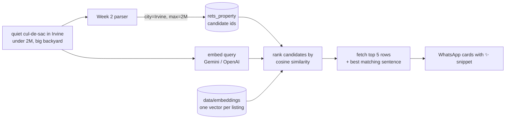

# Week 6: Semantic Search on Listing Descriptions

**Goal:** match what people *describe* ("quiet street with a big backyard") to what listing agents *wrote* in `L_Remarks`, even when the words are different.

## How it works

Hybrid search: SQL for the hard facts, embeddings for the feel.



1. **Index (once, then incremental):** each active listing's text (`type, city, beds, baths, sqft + L_Remarks`) is embedded and saved to `data/embeddings/` (gitignored). Unchanged descriptions are skipped on re-runs.
2. **Search:** the parser pulls hard filters, SQL returns the ids that pass them, the query is embedded, and only those ids are ranked. Top 50 max, 5 per page.
3. **Explain:** each card shows the sentence(s) of the description that best match the request.

The assistant switches to description search automatically when a message has descriptive words left over after removing filters, cities and filler (`descriptiveTerms()`). "3 bed condos in Irvine under 1.5M" stays a normal search. Asking for a sort ("cheapest first") switches back to normal filter order.

## Provider choice

| | Gemini (default) | OpenAI |
|---|---|---|
| Model | `gemini-embedding-2` | `text-embedding-3-small` |
| Key | `GEMINI_API_KEY` (already have it for OpenClaw) | `OPENAI_API_KEY` (handbook's plan, not set up yet) |
| Dims | 768 | 768 (via `dimensions`) |
| Switch | `EMBEDDING_PROVIDER=gemini` | `EMBEDDING_PROVIDER=openai` |

Gemini is default since the key already works. If the mentor wants OpenAI, set the key + `EMBEDDING_PROVIDER=openai` and run `npm run embed:index -- --rebuild` (vectors from different models can't be mixed; the code refuses to search a mismatched index).

## Files

- `src/semantic/embeddings.ts`: Gemini, OpenAI and Fake (tests) providers, normalization, retry on 429/5xx.
- `src/semantic/vectorStore.ts`: on-disk store (`vectors.f32` + ids + hashes), brute-force top-k, atomic saves.
- `src/semantic/semanticSearch.ts`: descriptive-term detection, listing text, hybrid search, snippets.
- `src/semantic/formatSemantic.ts`: WhatsApp cards with ✨ snippet and an "only N of M indexed" note.
- `src/semantic/indexCli.ts`: `npm run embed:index` (dry-run, `--city`, `--limit`, resumable, `--rebuild`).
- `src/semantic/semanticCli.ts`: `npm run semantic` to try it directly.
- `src/db/queries.ts`: `listingWhere()` shared by normal + semantic search, `buildCandidateIdsQuery`, `buildListingsByIdsQuery`, `buildRemarksPageQuery`.
- `src/agent/handleMessage.ts`: routes descriptive messages, keeps the description in the session so "more" / "only ones with a pool" keep working.

### Why a file and not a vector database?

55K listings × 768 floats ≈ 170 MB. Loading takes about a second and scanning all of it is tens of milliseconds, so a plain file is simpler and has nothing to install. Upgrade path if it grows: MySQL 9 `VECTOR`, pgvector, or a FAISS/HNSW index.

## Run it

```bash
cd ~/idx-openclaw-assistant
# 1) put the Gemini key in the project .env (same value as ~/.openclaw/.env)
grep GEMINI_API_KEY ~/.openclaw/.env >> .env

# 2) see how big a full run is (no API calls)
npm run embed:index -- --dry-run

# 3) start small, then do the rest (Ctrl+C is safe, re-run resumes)
npm run embed:index -- --city Irvine
npm run -s semantic -- "quiet cul-de-sac in Irvine with a big backyard"
npm run embed:index

# 4) through the assistant
npm run -s chat -- --user me "modern condo in San Diego with ocean views"
npm run -s chat -- --user me "only ones with a rooftop deck"
npm run -s chat -- --user me "more"
```

## Tests

- `npm test`: providers (fetch stubbed, checks request shape, retry, no key leaks), vector store, term detection, snippets, hybrid search, full conversations. Uses the Fake provider, so no key or network.
- `npm run test:db`: candidate ids agree with normal search, fetch-by-ids caps at 50, remarks paging has no repeats.

## Known limits / next steps

- Only listings with an embedding are ranked; the reply says when coverage is partial.
- Semantic results are capped at the top 50 matches.
- Not yet tested against the live Gemini API from this repo (the request format follows Google's docs and is unit tested). First real run: `--city Irvine`.
- Embeddings must be refreshed when listings change: re-run `npm run embed:index` (only new/changed ones are sent).
